# 词云与简单 NLP 分析报告

**——高中语文必背古诗文 60 篇的“数据画像”**

数据口径：60 篇正文，13194 个汉字（含扩展 B 区 2 字，剔除教材出处标注）　｜　分析日期：2026-10-29

---

## 一、做了什么

| 环节 | 做法 |
| --- | --- |
| 分词 | jieba 分词 + 古汉语虚词停用表 + 自定义词典（明月、故国、东风、君子等 2–3 字实词/意象） |
| 词云 | 词频加权、中文字体渲染，分全库、文言文、诗词曲、唐宋、主题五张 |
| 字/词频 | 汉字频次（去标点）与词语频次（jieba），各出 Top30 |
| 意象 | 自建 75 字意象表（山水自然、天象时令、草木鸟兽、人情家国、色彩光影、情态意境 6 类） |
| TF-IDF | 篇目级关键词，全库与分卷各一份 |
| 体裁对比 | 篇均字数、句长、用字丰富度 TTR、虚词占比 |
| 相似度 | 字符 bigram 的 TF-IDF 加权余弦相似度，60×60 矩阵 + 20 篇代表矩阵 + Top20 篇目对 |

> 一句话：60 篇合计只有 1.32 万字，样本很小，所有比例都只描述“本套必背篇目”，不宜外推整个古代文学。

---

## 二、全库画像：虚词撑骨架，“人”字最重

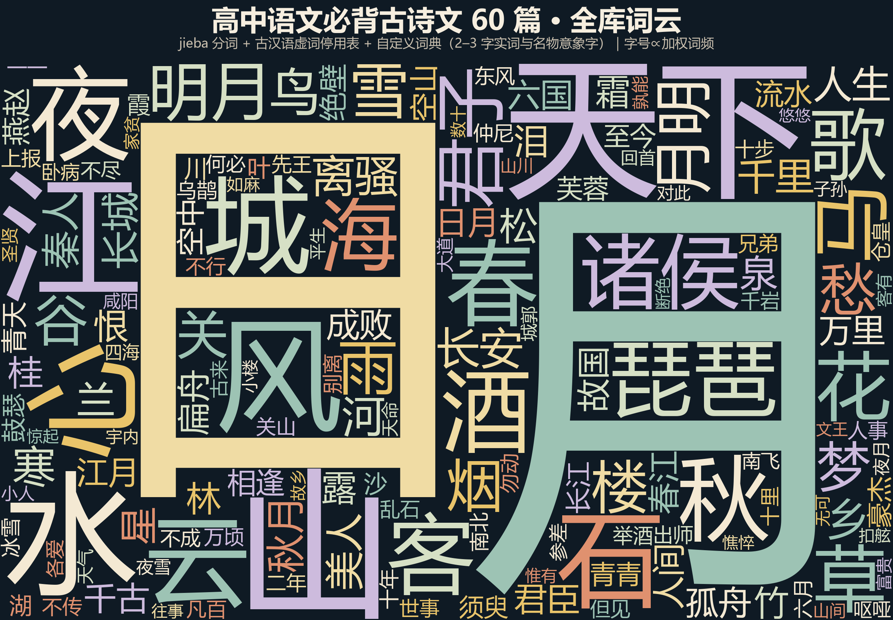

- 汉字频次 Top10：**之 385、而 234、不 233、以 168、也 154、人 136、其 135、为 104、有 102、者 98**——前十里 8 个是虚词。
- 第一个实词是“人”（136 次，约每千字 10.3 次），其次是有 102、子 83（多为人称“君子/夫子/小子”）、天 76、一 75。
- 高频词（jieba）：**天下 26、诸侯 10、君子 8、明月 8、琵琶 7、离骚 5、千里 4、圣人 4、秦人 4、美人 4**。
  “天下/诸侯/君子/圣人/秦人”几乎全部来自文言文（政论、史论、诸子），而“明月/美人/琵琶”来自诗词——**词频表本身就分出了两套话语体系**。

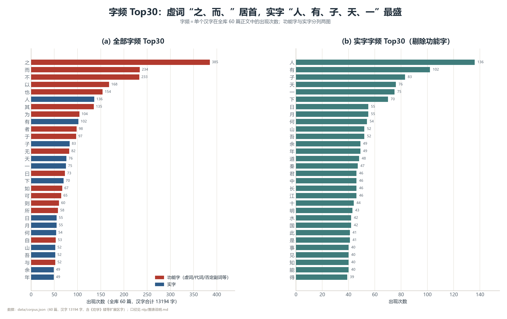

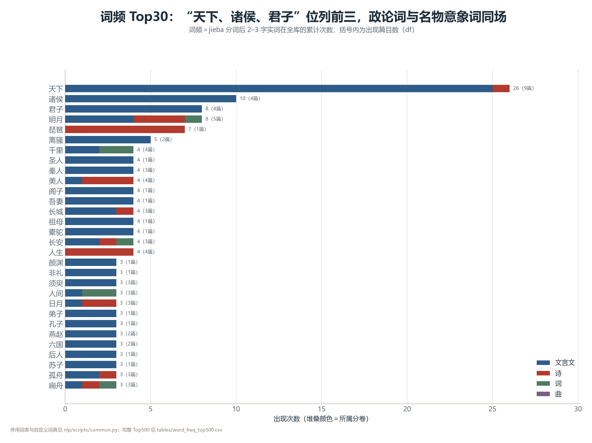

---

## 三、意象地图：月与江属于诗词，日与天下属于文章

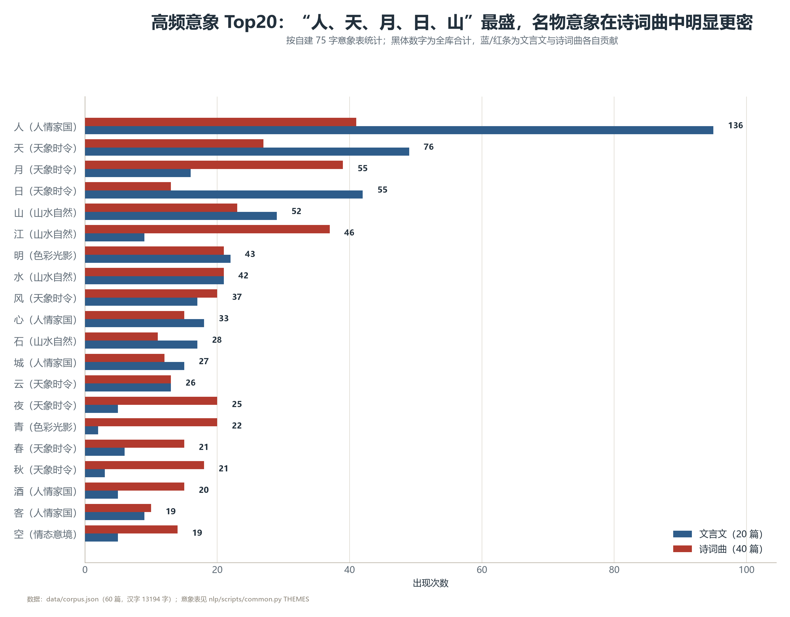

按“每千字出现率”比较文言文与诗词曲，差别最明显的意象是：

| 意象 | 全库次数 | 文言文密度（‰） | 诗词曲密度（‰） | 解读 |
| --- | --- | --- | --- | --- |
| 月 | 55 | 1.85 | **8.61** | 诗词的“月”是抒情装置，文章里只是天文时间 |
| 江 | 46 | 1.04 | **8.17** | “江”在诗词中承载时间与离别 |
| 山 | 52 | 3.35 | 5.08 | 诗词稍高，文章多实指地名 |
| 日 | 55 | **4.85** | 2.87 | 文章用“日”表时间/天象，诗词多写“日暮” |
| 天 | 76 | 5.66 | 5.96 | 两边都高，含义不同（天命 vs 天涯） |
| 人 | 136 | **10.96** | 9.05 | 文章谈“人事/人心”，诗词写“人”本身 |

> 结论：**“月、江、风”是诗词曲的高密度符号；“日、人、天下”是文言文的高密度符号**。背诵时可按此归类意象。

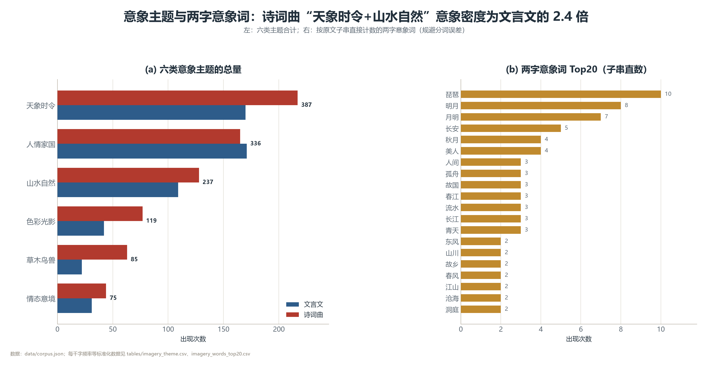

---

## 四、体裁差异：文章长句多虚词，诗词短句重用字

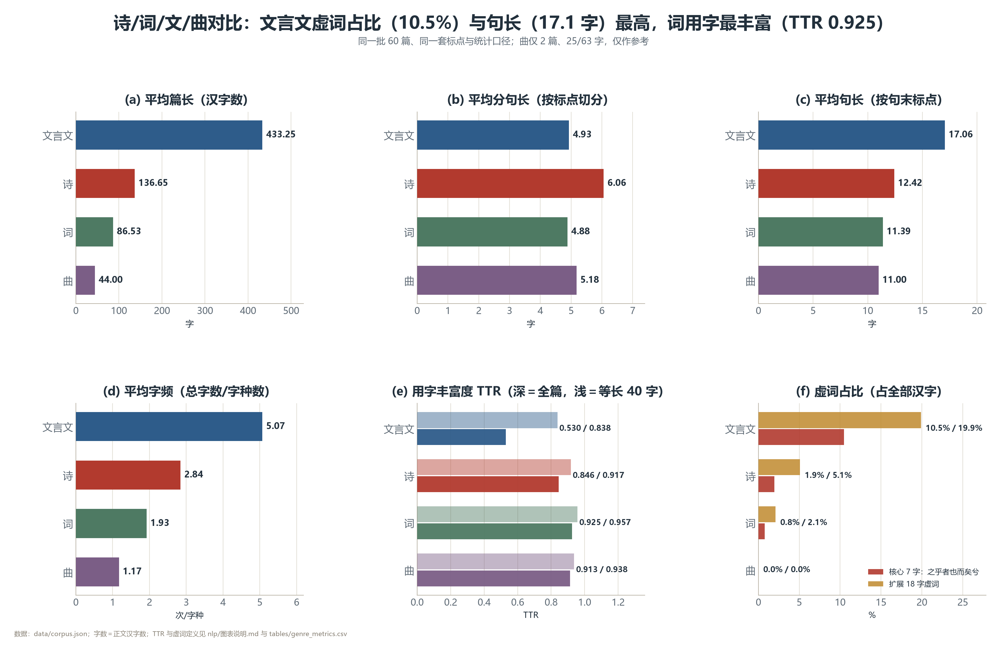

| 体裁 | 篇数 | 篇均字数 | 平均句长 | 核心虚词占比 | TTR（等长 40 字） |
| --- | --- | --- | --- | --- | --- |
| 文言文 | 20 | 433.2 | 17.1 | 10.5% | 0.838 |
| 诗 | 23 | 136.7 | 12.4 | 1.9% | 0.917 |
| 词 | 15 | 86.5 | 11.4 | 0.8% | 0.957 |
| 曲 | 2 | 44.0 | 11.0 | 0% | 0.938 |

- 文言文篇均是诗的 3 倍多，句长多 4–6 字，虚词占比是诗词的 5–10 倍；“之乎者也而矣兮”基本是文章的骨架。
- **词、曲的用字丰富度最高**（TTR 0.94–0.96），因为篇幅短、重复少；文言文 TTR 最低，因为长篇议论反复使用同一套虚词与术语。
- 这也解释了背诵体验：文章难在“虚词+长句”，诗词难在“意象+用典”。

---

## 五、朝代与作者：唐 30%、宋 35%

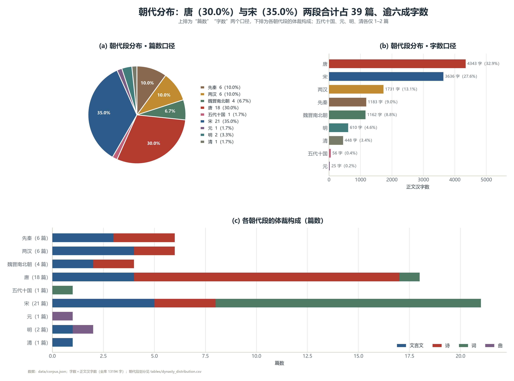

| 朝代段 | 篇数 | 占比 | 汉字数 | 代表 |
| --- | --- | --- | --- | --- |
| 先秦 | 6 | 10.0% | 1183 | 《论语》、劝学、静女、无衣、离骚 |
| 两汉 | 6 | 10.0% | 1731 | 屈原列传、过秦论、报任安书、短歌行 |
| 魏晋南北朝 | 4 | 6.7% | 1162 | 陈情表、归去来兮辞、归园田居、拟行路难 |
| 唐 | 18 | 30.0% | 4343 | 师说、阿房宫赋、蜀道难、将进酒、琵琶行…… |
| 五代十国 | 1 | 1.7% | 56 | 虞美人 |
| 宋 | 21 | 35.0% | 3636 | 六国论、赤壁赋、念奴娇、永遇乐…… |
| 元 | 1 | 1.7% | 25 | 长亭送别 |
| 明 | 2 | 3.3% | 610 | 项脊轩志、朝天子·咏喇叭 |
| 清 | 1 | 1.7% | 448 | 登泰山记 |

- **唐宋两代合计 39 篇（65%）、7979 字（60.5%）**，是必背篇目的绝对主体。
- 作者榜：**苏轼 4 篇（1210 字）、杜甫 4 篇（208 字）、李白 3 篇、辛弃疾 3 篇**；苏轼一人横跨文言文与词，是“数据上的第一主角”。

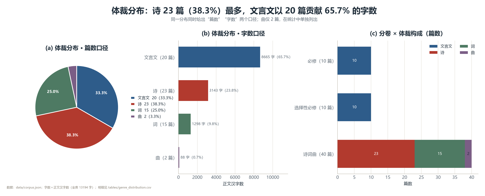

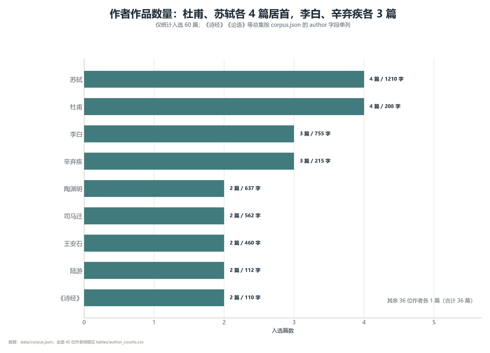

---

## 六、TF-IDF：每篇的“指纹”

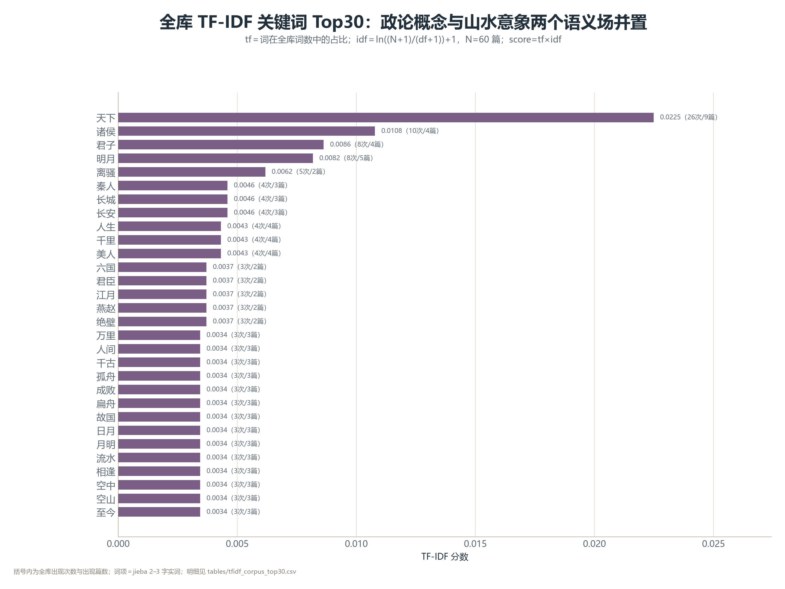

- 全库 TF-IDF 最高的词是“**天下**”，其后是“诸侯、君子、明月、琵琶、离骚、圣人”等——与词频榜高度重合，说明 60 篇的主题词非常集中。
- 分卷 TF-IDF（见 figs/13）能清楚看到：必修卷偏“师道、六国、阿房”，选择性必修卷偏“陈情、归去、种树”，诗词曲卷偏“明月、东风、故国”。
- 篇目级关键词见 nlp/tables/tfidf_per_piece_top5.csv，可当“一句话内容提要”用。

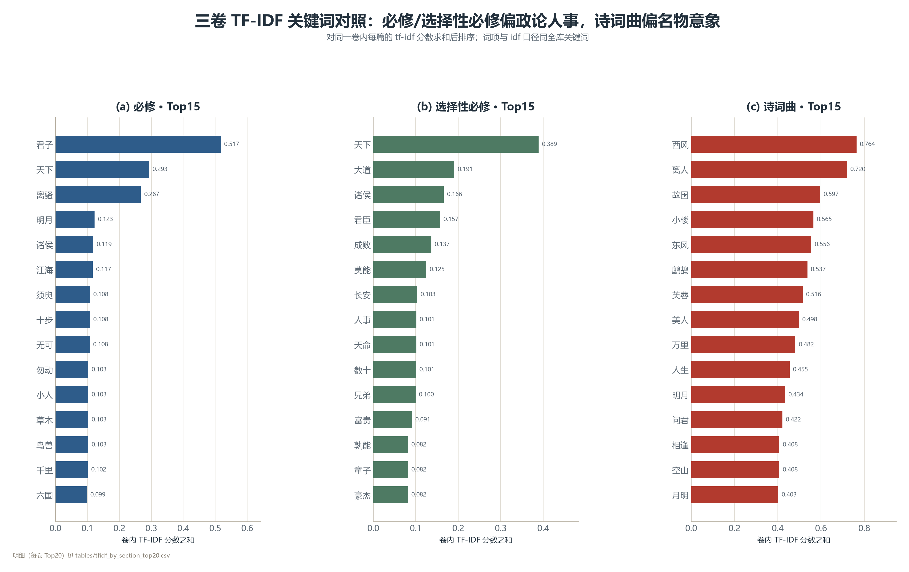

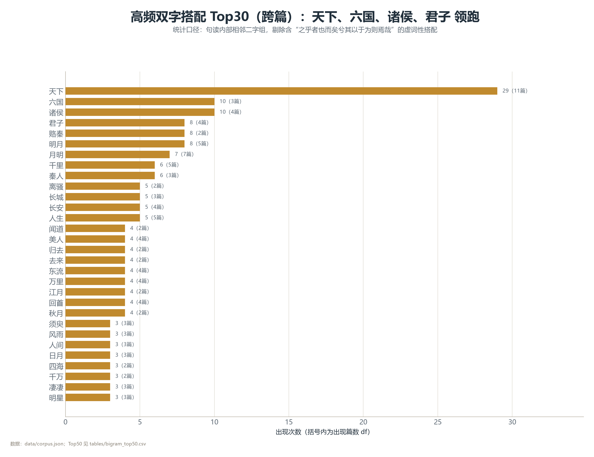

- 高频双字搭配：**天下 29 次（跨 11 篇）**、六国 10、诸侯 10、君子 8、赂秦 8、明月 8；“月明”只有 7 次却横跨 7 篇，是最“通用”的诗词组合（“明月”则集中在 5 篇）。
- 这说明 60 篇的“公共语汇”很小：天下/六国/诸侯/君子/明月/月明 六组就撑起了大半主题词。

---

## 七、相似度：政论类文言文最“撞车”

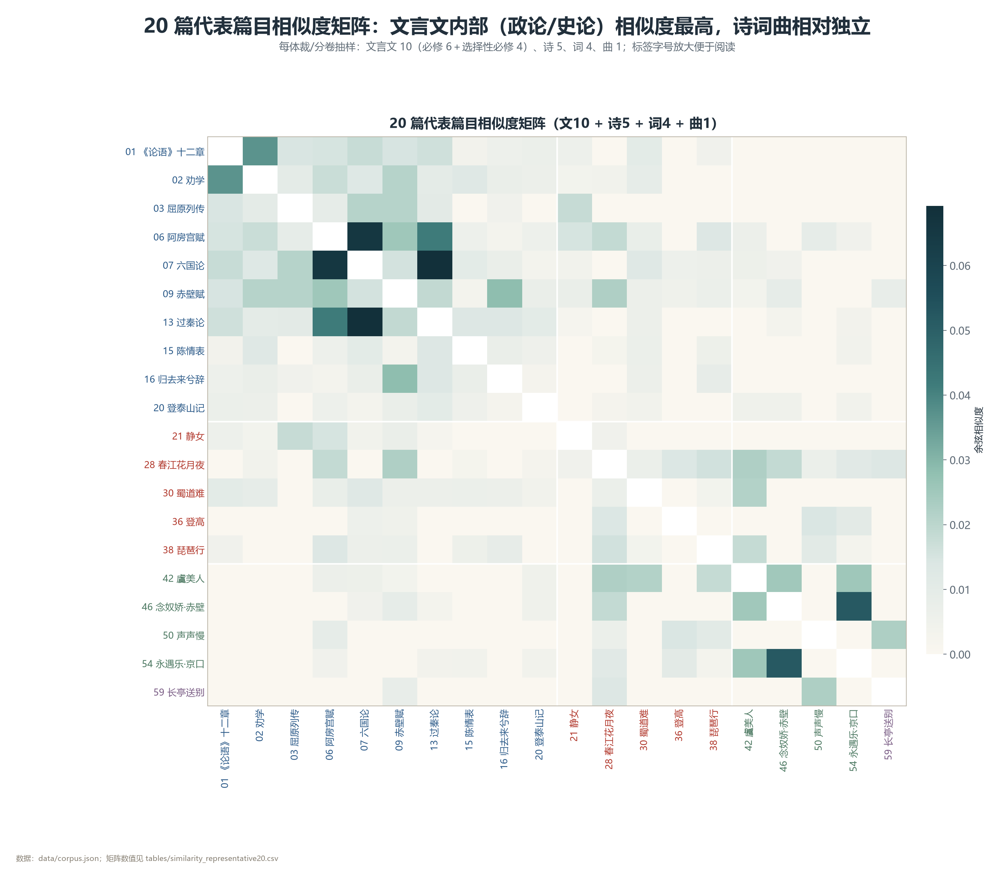

- 60 篇两两相似度普遍很低（最高 0.069），说明选文题材跨度大；但**同体裁明显聚块**：Top20 相似篇目对里 18 对是同体裁（90%）。
- 最相似的 5 对：

| 排名 | 篇目对 | 相似度 | 解读 |
| --- | --- | --- | --- |
| 1 | 六国论 × 过秦论（上） | 0.069 | 都是“史论+政论”，句式与论证词高度重合 |
| 2 | 阿房宫赋 × 六国论 | 0.0658 | 赋体铺陈与史论共用“六国/天下/秦”语汇 |
| 3 | 念奴娇·赤壁怀古 × 永遇乐·京口北固亭怀古 | 0.052 | 豪放词双璧，怀古结构一致 |
| 4 | 师说 × 礼运 | 0.047 | 都谈“教/学/礼”，四字句多 |
| 5 | 师说 × 石钟山记 | 0.043 | 议论句式相近 |

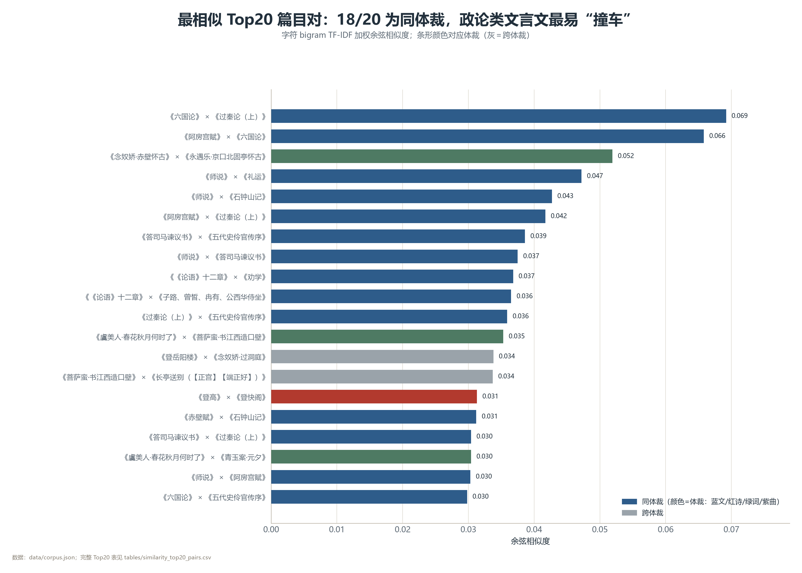

---

## 八、结论与学习启示

1. **两套话语体系**：文言文＝虚词+长句+天下/诸侯/圣人；诗词曲＝意象+短句+月/江/风/酒。背诵策略应分开：文章抓虚词与论证结构，诗词抓意象与情感线。
2. **高频字就是默写易错字来源**：“之、而、不、以、也、其、为、者、于”出现最多，也是“地/的/得、已/己、惟/唯”等易错的温床；重点篇目要多写多默。
3. **唐宋是主战场**：65% 篇目集中在唐宋，复习时间分配可按此倾斜。
4. **苏轼是“必背第一人”**：4 篇 1210 字，且横跨文与词，可做专题串联（赤壁赋 × 念奴娇 × 石钟山记 × 江城子）。
5. **相似篇目可打包记忆**：六国论/过秦论/阿房宫赋（史论政论组）、念奴娇/永遇乐（豪放怀古组）、师说/礼运（议论组），成组背诵效率更高。

---

## 九、文件清单

- 词云与图表：nlp/figs/（01–19，共 22 个 PNG）
- 数据表：nlp/tables/（字频、词频、意象、TF-IDF、相似度、体裁指标等 20+ CSV）
- 分析工具：jieba（分词）、matplotlib（绘图）、wordcloud（词云）、Pillow（字体）
- 技术说明：nlp/图表说明.md
