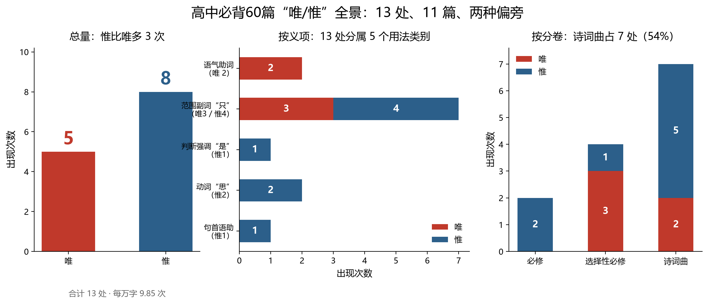
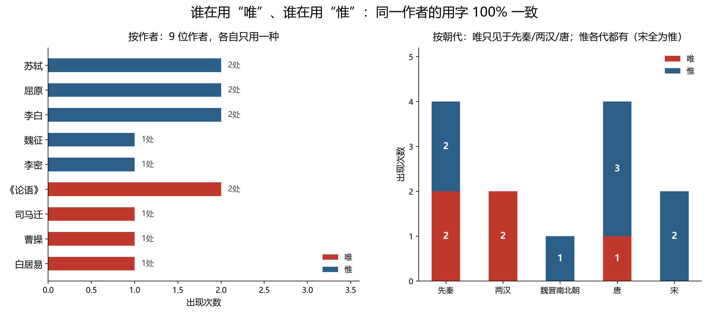
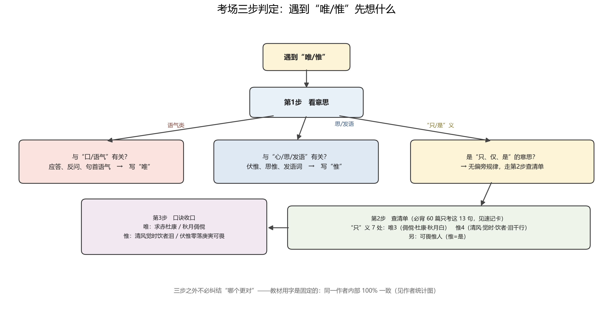
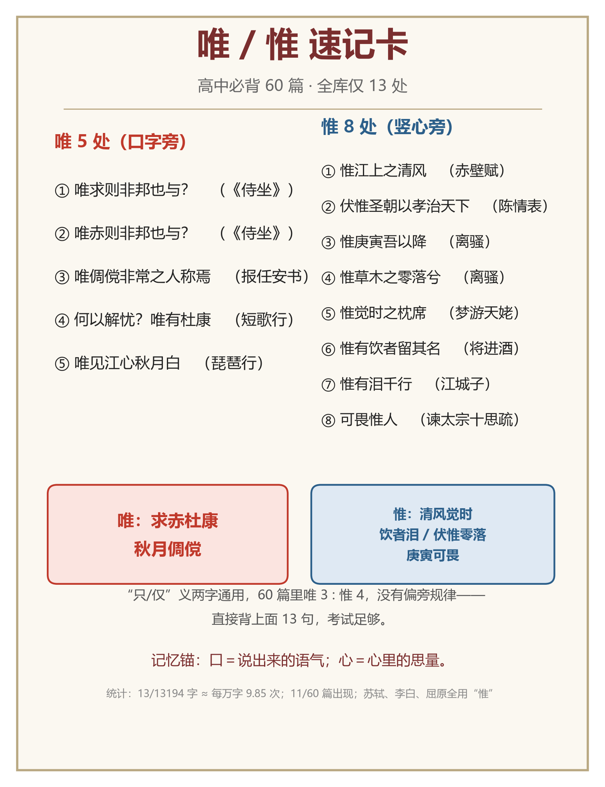

# “唯”与“惟”辨析速记

**——基于《高中语文必背古诗文60篇》的全量统计（13 处 / 11 篇 / 13194 字）**

整理日期：2026 年 10 月 29 日　　语料：新课标 72 篇扣除 12 篇选修文言文后的必背 60 篇

---

## 一、30 秒结论

1. **必背 60 篇里“唯/惟”一共只出现 13 次，分布在 11 篇**：唯 5 次、惟 8 次，平均每万字 9.8 次。49 篇里根本没有这两个字。
2. **真正有规律的是非“只”义**：口字旁“唯”管**语气/应答**（唯求、唯赤）；竖心旁“惟”管**思/发语**（伏惟、惟草木、惟庚寅）。这 5 处 100% 符合偏旁。
3. **“只、仅”义两字通用**：60 篇中唯 3 : 惟 4，没有偏旁、文体、朝代的硬规律。教材用字是“死”的，但**同一作者内部 100% 一致**：苏轼 2 处全用惟、屈原 2 处全用惟、李白 2 处全用惟；《论语》2 处、司马迁、曹操、白居易全用唯。
4. **应考只需要背 13 句封闭清单**（下面两句口诀），再加一张现代规范词表，不必在义理上纠缠。
5. **现代汉语**：词典推荐“唯有、唯一、唯独、唯恐、唯美、唯物、唯心、唯利是图、唯命是从、唯我独尊”用“唯”；“惟”主要保留在**惟妙惟肖**和连词**不惟**（=不但）里。

---

## 二、统计口径

| 项目 | 说明 |
| --- | --- |
| 语料范围 | 新课标古诗文背诵推荐篇目 72 篇 − 12 篇选修文言文 = **60 篇** |
| 构成 | 文言文 20 篇（必修 10 + 选择性必修 10）＋ 诗词曲 40 首 |
| 统计字数 | **13194 个汉字**（含扩展 B 区 2 字，已剔除教材出处标注；不含标点、空白、标题） |
| 统计对象 | 正文中“唯”“惟”的每一次出现，逐处人工归类义项 |
| 用字依据 | 人教统编版教材用字；并与《高考必背60篇》注释本、识典古籍抽查比对 |
| 局限 | 古籍异文、不同版本偶有“唯/惟”出入；选修 12 篇不要求默写，未纳入统计 |

---

## 三、13 处全清单

| 序号 | 篇目 | 原句 | 字 | 义项 | 释义 |
| --- | --- | --- | --- | --- | --- |
| 1 | 子路、曾皙、冉有、公西华侍坐 | 唯求则非邦也与？ | 唯 | 语气助词 | 用于句首，无实义，引出反问 |
| 2 | 子路、曾皙、冉有、公西华侍坐 | 唯赤则非邦也与？ | 唯 | 语气助词 | 同上 |
| 3 | 报任安书 | 唯倜傥非常之人称焉 | 唯 | 范围副词 | 只、仅 |
| 4 | 短歌行 | 何以解忧？唯有杜康 | 唯 | 范围副词 | 只、仅 |
| 5 | 琵琶行（并序） | 唯见江心秋月白 | 唯 | 范围副词 | 只、仅 |
| 6 | 谏太宗十思疏 | 怨不在大，可畏惟人 | 惟 | 判断强调 | 是；可怕的是人民 |
| 7 | 赤壁赋 | 惟江上之清风 | 惟 | 范围副词 | 只、仅 |
| 8 | 陈情表 | 伏惟圣朝以孝治天下 | 惟 | 动词 | 思、想（伏惟：伏地思量，表敬） |
| 9 | 离骚（节选） | 惟庚寅吾以降 | 惟 | 句首语助 | 发语词，无实义 |
| 10 | 离骚（节选） | 惟草木之零落兮 | 惟 | 动词 | 思、念及 |
| 11 | 梦游天姥吟留别 | 惟觉时之枕席 | 惟 | 范围副词 | 只、仅 |
| 12 | 将进酒 | 惟有饮者留其名 | 惟 | 范围副词 | 只、仅 |
| 13 | 江城子·乙卯正月二十日夜记梦 | 惟有泪千行 | 惟 | 范围副词 | 只、仅 |

**分布小结**

- 按分卷：必修 2 处（皆惟）｜选择性必修 4 处（唯 3、惟 1）｜诗词曲 7 处（唯 2、惟 5）。
- 按体裁：文言文 6 处（唯 3、惟 3）｜诗词曲 7 处（唯 2、惟 5）。
- 按朝代：先秦 4（唯 2、惟 2）｜两汉 2（皆唯）｜魏晋南北朝 1（惟）｜唐 4（唯 1、惟 3）｜宋 2（皆惟）。
- 按义项：范围副词“只”7 处（唯 3、惟 4）｜语气助词 2 处（皆唯）｜动词“思”2 处（皆惟）｜判断强调“是”1 处（惟）｜句首语助 1 处（惟）。

---

## 四、字源：口与心的分工

| 字 | 字形 | 本义 | 引申 | 60 篇中的典型用例 |
| --- | --- | --- | --- | --- |
| 唯 | 从**口**，隹声 | 应答声（唯唯诺诺） | ①句首语气 ②范围副词“只” | 唯求、唯赤；唯有杜康、唯见江心秋月白 |
| 惟 | 从**心**，隹声 | 思、想（思惟） | ①动词“思” ②范围副词“只” ③句首语助 | 伏惟、惟草木之零落兮；惟江上之清风、惟庚寅吾以降 |
| 维 | 从**糸**，隹声 | 系、连接 | 维系、纤维、思维 | 不是“唯/惟”，写“思维”“维系”只能用维 |

**关键原理**：“隹”只是声旁，形旁才决定本义方向——**口＝说出来的语气，心＝心里的思量**。至于“只、仅”这个意思，是后起的假借用法，两个字都能写，所以**不可能有偏旁规律**。这正是“唯/惟”难分的根源。

> 一句话记忆锚：**口唯心惟；不是糸，不写维。**

---

## 五、五类用法，一句一例

**① 唯·语气助词（2 处，全在《侍坐》）**

- 唯求则非邦也与？／唯赤则非邦也与？——用于句首，无实义，引出反问。

**② 唯·范围副词“只、仅”（3 处）**

- 唯倜傥非常之人称焉（《报任安书》）
- 何以解忧？唯有杜康（《短歌行》）
- 唯见江心秋月白（《琵琶行》）

**③ 惟·范围副词“只、仅”（4 处）**

- 惟江上之清风（《赤壁赋》）
- 惟觉时之枕席（《梦游天姥吟留别》）
- 惟有饮者留其名（《将进酒》）
- 惟有泪千行（《江城子》）

**④ 惟·判断强调“是”（1 处）**

- 怨不在大，可畏惟人（《谏太宗十思疏》）——可畏惧的是人民。

**⑤ 惟·动词“思”/句首语助（3 处）**

- 伏惟圣朝以孝治天下（《陈情表》）——伏惟：伏地思量，表敬。
- 惟草木之零落兮（《离骚》）——思及草木零落。
- 惟庚寅吾以降（《离骚》）——句首发语词，无实义。

---

## 六、检验：网上流传的 4 条“规律”靠谱吗

| 流传说法 | 60 篇检验结果 | 判定 |
| --- | --- | --- |
| “口字旁用唯，竖心旁用惟” | 非“只”义 5 处全部符合：唯求/唯赤（语气）、伏惟/惟草木/惟庚寅（心/发语） | ✅ 成立，但**只管非“只”义** |
| “‘只有’的意思一律写惟” | “只”义 7 处：唯 3（倜傥、杜康、秋月白）、惟 4 | ❌ 不成立 |
| “诗词用唯、文章用惟” | 文言文 唯 3 : 惟 3；诗词曲 唯 2 : 惟 5 | ❌ 不成立 |
| “哪个朝代以后才固定” | 先秦已 2 : 2 并用；唐 1 : 3；宋 0 : 2 | ⚠️ 样本太小，只能说本语料宋代 2 处全用惟 |
| “同一作者用字一致”（本报告补充） | 9 位作者内部 100% 一致：苏轼 2/2 惟、屈原 2/2 惟、李白 2/2 惟、孔子 2/2 唯、司马迁/曹操/白居易全唯 | ✅ 成立，**最好用的辅助记忆** |

结论：**不要试图用一条义理规则通吃**。“唯/惟”在“只”义上属于历代混用，教材用字继承底本；考试默写只认教材，所以最稳的策略是**把 13 处当成封闭清单背下来**。

---

## 七、三步速记法

### 第 1 步：看意思，先分“是不是只/仅/是”

- 与**口/语气**有关（应答、反问、句首语气）→ 写**唯**。
- 与**心/思/发语**有关（伏惟、思惟、发语词）→ 写**惟**。
- 是**“只、仅、是”** → 进入第 2 步（偏旁帮不上忙）。

### 第 2 步：查 13 句清单（60 篇只考这些）

### 第 3 步：两句口诀收口

> **唯（5 处）：求赤杜康，秋月倜傥**
> 　唯求、唯赤、唯有杜康、唯见江心秋月白、唯倜傥非常之人

> **惟（8 处）：清风觉时，饮者泪行；伏惟零落，庚寅可畏**
> 　惟江上之清风、惟觉时之枕席、惟有饮者留其名、惟有泪千行、伏惟圣朝、惟草木之零落、惟庚寅吾以降、可畏惟人

### 故事串记（按时代把 13 句串成一条线）

孔子问志，**唯**求、**唯**赤（语气）；司马迁叹**唯**倜傥非常之人；曹操对酒**唯**有杜康；白居易听琵琶**唯**见江心秋月白；魏征进谏，可畏**惟**人；李密陈情，伏**惟**圣朝；屈原自述**惟**庚寅、**惟**草木零落；李白梦天姥**惟**觉时之枕席、将进酒**惟**有饮者留其名；苏轼泛舟**惟**江上之清风、梦亡妻**惟**有泪千行。

---

## 八、现代汉语怎么写

“唯”与“惟”在“只、单”义上是**异形词**，古书常通用；现代汉语以词典推荐词形为准（参见《人民日报·海外版》2025 年 4 月 5 日杜永道《“唯有”与“惟有”》）：

| 场合 | 推荐写法 | 说明 |
| --- | --- | --- |
| “只、单”义现代词语 | **唯** | 唯有、唯一、唯独、唯恐、唯美、唯其、唯物、唯心、唯利是图、唯命是从、唯我独尊 |
| 固定成语 | **惟** | 惟妙惟肖（“惟”是语气助词） |
| 连词“不但” | **惟** | 不惟无益，亦有害 |
| “思、想”义 | 现代写**思维**（用维） | “思惟”是旧写法，作文不建议用 |
| 系、连接义 | **维** | 维系、维护、纤维、维生素——不要写成“惟/唯” |

> 考试口径：**默写只看教材**（本报告清单即统编版用字）；**作文现代文**按上表推荐词形写，避免“惟一/惟有”与“唯一/唯有”混用被扣分。

---

## 九、默写自测（13 题，答案见文末）

1. （　）求则非邦也与？（《侍坐》）
2. （　）赤则非邦也与？（《侍坐》）
3. 古者富贵而名摩灭，不可胜记，（　）倜傥非常之人称焉。（《报任安书》）
4. 何以解忧？（　）有杜康。（《短歌行》）
5. 东船西舫悄无言，（　）见江心秋月白。（《琵琶行》）
6. 怨不在大，可畏（　）人。（《谏太宗十思疏》）
7. （　）江上之清风，与山间之明月。（《赤壁赋》）
8. 伏（　）圣朝以孝治天下。（《陈情表》）
9. 摄提贞于孟陬兮，（　）庚寅吾以降。（《离骚》）
10. （　）草木之零落兮，恐美人之迟暮。（《离骚》）
11. （　）觉时之枕席，失向来之烟霞。（《梦游天姥吟留别》）
12. 古来圣贤皆寂寞，（　）有饮者留其名。（《将进酒》）
13. 相顾无言，（　）有泪千行。（《江城子》）

---

## 十、数据来源与文件

- 原始语料：data/corpus.json（60 篇结构化全文，含作者/朝代/体裁/分卷）
- 明细数据：分析/唯惟明细.csv、分析/唯惟数据.json
- 篇目依据：《普通高中语文课程标准（2017 年版 2020 年修订）》古诗文背诵推荐篇目 72 篇
- 用字比对：人教统编版教材；GitHub 汇编 lailai0916/lailai0916.github.io（声明“用字从教材”）；长沙市教育局《高考必背60篇》注释本；识典古籍
- 语料已按独立校对报告修订 5 处（《五代史伶官传序》补“呜呼！”、《种树郭橐驼传》补“也”、清除《项脊轩志》《登泰山记》尾部解析残留、补《论语》十二章末章出处标注）；13 处唯/惟 13/13 核对一致，详见 校对/校对报告.md
- 现代规范：《现代汉语词典》推荐词形；《人民日报·海外版》2025-04-05 杜永道文
- 12 篇选修文言文（**不要求背诵**，故不在 60 篇内）：《老子》八章、季氏将伐颛臾、《大学》、《中庸》、《孟子》一则、逍遥游、谏逐客书、兰亭集序、滕王阁序、黄冈竹楼记、上枢密韩太尉书、古代文论选段

---

### 自测答案

1 唯　2 唯　3 唯　4 唯　5 唯　6 惟　7 惟　8 惟　9 惟　10 惟　11 惟　12 惟　13 惟
